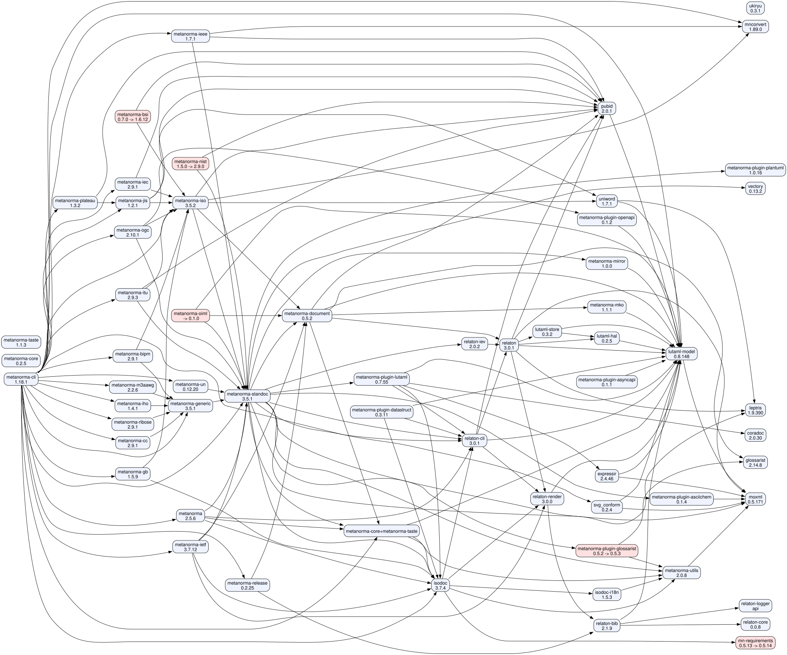

# metanorma release-family graph

The complete gem graph of the metanorma release family: every gem we
consolidate and release, its current main version vs the latest published
stable, the family-internal dependency edges (from the gemspecs, incl.
`add_runtime_dependency`), and the release order minimised into waves.

Generated from the gemspecs of `~/src/mn/*` checkouts (their proper remotes)
and the GitHub APIs; waves computed by Kahn topological sort over the family
edges, with strongly-connected components collapsed (see Consolidation).

## Release waves (dependency order)

Every gem in a wave has all of its family dependencies in earlier waves,
so each wave can be cut and released as one batch.

| Wave | Gems |
|---|---|
| W1 (11) | `coradoc`, `glossarist`, `leptris`, `metanorma-plugin-plantuml`, `mn-requirements`, `mnconvert`, `moxml`, `relaton-core`, `relaton-logger`, `ukiryu`, `vectory` |
| W2 (3) | `lutaml-model`, `metanorma-plugin-asciichem`, `metanorma-utils` |
| W3 (12) | `expressir`, `isodoc-i18n`, `lutaml-hal`, `metanorma-mirror`, `metanorma-mko`, `metanorma-plugin-asyncapi`, `metanorma-plugin-glossarist`, `metanorma-plugin-openapi`, `pubid`, `relaton-bib`, `svg_conform`, `uniword` |
| W4 (2) | `lutaml-store`, `relaton-render` |
| W5 (1) | `relaton` |
| W6 (2) | `relaton-cli`, `relaton-iev` |
| W7 (1) | `isodoc` |
| W8 (3) | `metanorma-core+metanorma-taste`, `metanorma-plugin-datastruct`, `metanorma-plugin-lutaml` |
| W9 (1) | `metanorma-document` |
| W10 (2) | `metanorma-release`, `metanorma-standoc` |
| W11 (8) | `metanorma`, `metanorma-generic`, `metanorma-ieee`, `metanorma-ietf`, `metanorma-iso`, `metanorma-nist`, `metanorma-oiml`, `metanorma-un` |
| W12 (11) | `metanorma-bipm`, `metanorma-bsi`, `metanorma-cc`, `metanorma-gb`, `metanorma-iec`, `metanorma-iho`, `metanorma-itu`, `metanorma-jis`, `metanorma-m3aawg`, `metanorma-ogc`, `metanorma-ribose` |
| W13 (1) | `metanorma-plateau` |
| W14 (1) | `metanorma-cli` |

## Needs release (main ahead of the published stable)

| Gem | main | latest stable | cut | Wave |
|---|---|---|---|---|
| `metanorma-bsi` | 1.6.12 | 0.7.0 | **1.6.12** | W12 |
| `metanorma-nist` | 2.9.0 | 1.5.0 | **2.9.0** | W11 |
| `metanorma-plugin-glossarist` | 0.5.3.pre.alpha.4 | 0.5.2 | **0.5.3** | W3 |
| `mn-requirements` | 0.5.14.pre.alpha.1 | 0.5.13 | **0.5.14** | W1 |

Notes: `metanorma-nist` / `metanorma-bsi` release to GitHub Packages, not
rubygems (their rubygems stables are the retired 1.x/0.7 lines);
`metanorma-oiml` has never been released — 0.1.0 is the first cut.

## Consolidation items the graph surfaced

- **Circular gemspec deps**: `metanorma-core` ↔ `metanorma-taste` and
  `metanorma-document` → `metanorma-mko` → `metanorma-standoc` →
  `metanorma-document` are real mutuals in the current gemspecs; their
  members are collapsed into single waves (W8, W9+W10). De-cycling —
  `metanorma-document` dropping `metanorma-mko`, and the core/taste
  direction — would shrink the critical path by a wave.
- **Relaton monorepo**: relaton-bib / relaton-render / relaton-cli are
  cut from `relaton/relaton` (`gems/*`); relaton-core and relaton-logger
  are family gems the 1.18 graph newly carries.
- **Retired / private / data**: metanorma-csa (retired), metanorma-csd &
  metanorma-mpfd (riboseinc, retired), metanorma-nist & metanorma-bsi
  (private), metanorma-ietf-data & bipm-data-importer (data gems) are
  outside the release waves.
- **Local-checkout hygiene** (`~/src/mn`): duplicate/legacy checkouts of
  the same remotes exist — `coradoc-new` (→ metanorma/coradoc),
  `metanorma-plugin-lutaml-new` (→ metanorma/metanorma-plugin-lutaml),
  `metanorma-document-flavormodels` (→ metanorma/metanorma-document),
  `metanorma-ietf-pr257` (→ metanorma/metanorma-ietf), and the `wt-*`
  worktree litter. The canonical set used here is the checkout whose
  origin matches the gem's repo.

## Graph

The source is [`release-graph.dot`](release-graph.dot) — red nodes need
release; ranks are the waves.

